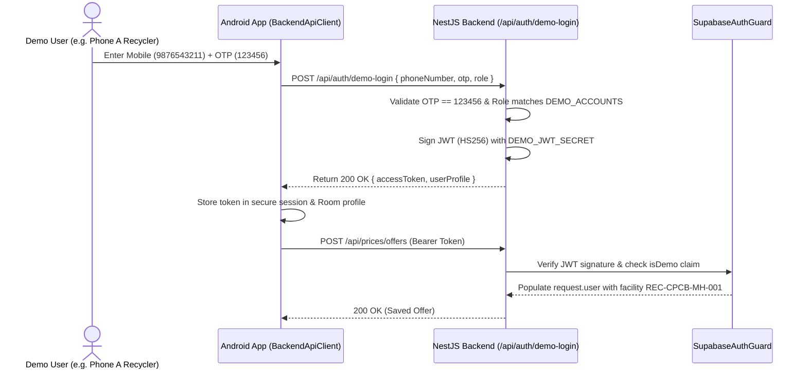

# ECOBRIDGES — Demo Login Architecture & Verification

## 1. Overview
The ECOBRIDGES platform includes a secured demo-login capability intended for hackathon evaluation and technical demonstrations. The fixed demonstration OTP is:
```text
123456
```

## 2. Security Boundaries & Architecture
Demo authentication is backend-mediated and role-enforced:
1. **Gating:** Demo login is enabled only when `DEMO_LOGIN_ENABLED=true`.
2. **Fixed OTP:** Validates against `DEMO_OTP_CODE` (default `123456`). Arbitrary codes are rejected with `401 Unauthorized`.
3. **Phone-to-Role Mapping:** Server-side mapping configured via `DEMO_ACCOUNTS`:
   - `9876543210`: Informal Collector (`informal_collector`)
   - `9876543211`: Formal Recycler (`formal_recycler`, assigned facility `REC-CPCB-MH-001`)
   - `9876543212`: Government Admin (`government_admin`, gated by `DEMO_ENABLE_ADMIN=true`)
4. **Self-Elevation Prevention:** An unlisted phone number cannot claim the `government_admin` role. Requesting a role different from the configured role results in `403 Forbidden`.
5. **Signed Token Generation:** On successful authentication, the backend signs an expiring HMAC-SHA256 JWT using `DEMO_JWT_SECRET` (fallback `SUPABASE_JWT_SECRET`).
   - Token claims include: `sub`, `email`, `role`, `roleSlug`, `statutoryIdentifier`, `facilityId`, `isDemo: true`, `iss: "ecobridges-backend"`, `aud: "authenticated"`, and `exp` (12 hours).
6. **Guard Verification:** `SupabaseAuthGuard` in NestJS validates both Supabase GoTrue asymmetric/symmetric tokens and backend-issued demo session tokens.
7. **Client Secure Storage:** Android client stores the token in `SharedPreferences` and supplies it via HTTP Bearer token in all API requests via `BackendApiClient`.

## 3. Demo Login Flow Diagram


## 4. Verification Status
* **Backend Demo Login & Guards:** IMPLEMENTED AND TESTED (`test/demo.auth.persistence.test.js` passes 100%).
* **Android Demo Client:** IMPLEMENTED AND TESTED (`AuthValidationTest`, `DemoAuthConfigTest`, `DemoRoleAccessTest` pass).
* **Cross-Device Persistence:** IMPLEMENTED BUT NOT INTEGRATION-TESTED against live Supabase (fully tested against local mock/in-memory test server).

